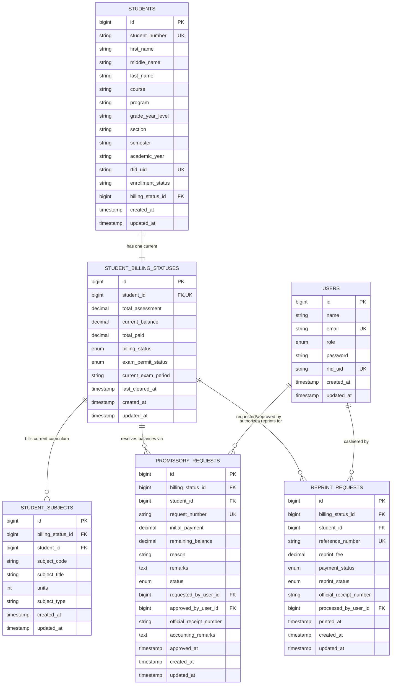

# PermEase Database Infrastructure Specification

> [!NOTE]
> **System Architecture Core Principle**:  
> PermEase is architected as a lean, **current-state single-source-of-truth** system. It does **not** archive historical subject enrollments or historical year/section transitions. When a student is promoted or enrolled in a new term, their year level, section, and enrolled subjects are updated **in-place**. All functional operational tables (students, subjects, promissory notes, and reprints) are interconnected through the **Student Billing Status**.

---

## 1. Entity-Relationship Overview (ERD)

The diagram below details how each table links directly into `student_billing_statuses`:



---

## 2. In-Place Promotion & Non-Historical Design

> [!IMPORTANT]
> **No Historical Subject or Section Logs:**
> - When a student is promoted from **1st Year** to **2nd Year** (or moves to the next semester):
>   1. The `students` record is updated directly: `grade_year_level`, `section`, `semester`, and `academic_year` are modified in-place.
>   2. The associated records in `student_subjects` for that student/billing status are deleted and replaced with the new curriculum, or updated in-place. No previous semester subjects are retained in the database.
>   3. The `student_billing_statuses` is recalculated and reset with the new semester's assessment and active balance.

---

## 3. Table Schema Specifications

### 3.1. `students` (Student Master Table)
Stores primary demographic and current academic profile. When a student advances, their academic details are updated here directly.

| Column | Type | Nullable | Default | Description |
|---|---|---|---|---|
| `id` | `BIGINT UNSIGNED` | No | Auto Increment | Primary Key |
| `student_number` | `VARCHAR(32)` | No | — | Unique Student ID (e.g. `2024-00101`) |
| `first_name` | `VARCHAR(100)` | No | — | First Name |
| `middle_name` | `VARCHAR(100)` | Yes | `NULL` | Middle Name |
| `last_name` | `VARCHAR(100)` | No | — | Last Name / Surname |
| `course` | `VARCHAR(150)` | No | — | Degree Program (e.g. `BS Information Technology`) |
| `program` | `VARCHAR(50)` | No | — | Program Code (e.g. `BSIT`, `BSCS`, `BSBA`) |
| `grade_year_level` | `VARCHAR(20)` | No | — | Current Year Level (updated in-place on promotion) |
| `section` | `VARCHAR(20)` | No | — | Current Section (updated in-place on promotion) |
| `semester` | `VARCHAR(30)` | No | — | Current Semester (e.g. `1st Semester`, `2nd Semester`) |
| `academic_year` | `VARCHAR(30)` | No | — | Current Academic Year (e.g. `2024-2025`) |
| `rfid_uid` | `VARCHAR(64)` | Yes | `NULL` | Contactless RFID UID linked to student |
| `enrollment_status` | `ENUM('ENROLLED','DROPPED','GRADUATED')` | No | `'ENROLLED'` | Operational student status |
| `billing_status_id` | `BIGINT UNSIGNED` | Yes | `NULL` | Direct Foreign Key pointer to active `student_billing_statuses.id` |
| `created_at` | `TIMESTAMP` | Yes | `CURRENT_TIMESTAMP` | Initial enrollment date |
| `updated_at` | `TIMESTAMP` | Yes | `CURRENT_TIMESTAMP` | Last updated timestamp |

**Indexes & Constraints**:
- `PRIMARY KEY (id)`
- `UNIQUE KEY uk_student_number (student_number)`
- `UNIQUE KEY uk_rfid_uid (rfid_uid)`
- `INDEX idx_students_billing_status (billing_status_id)`
- `FOREIGN KEY (billing_status_id) REFERENCES student_billing_statuses(id) ON DELETE SET NULL`

---

### 3.2. `student_billing_statuses` (Central Billing Status Table)
The core operational pivot of the system. Controls permit printing authorization on the kiosk terminal, current balance, and settlement flags.

| Column | Type | Nullable | Default | Description |
|---|---|---|---|---|
| `id` | `BIGINT UNSIGNED` | No | Auto Increment | Primary Key |
| `student_id` | `BIGINT UNSIGNED` | No | — | Foreign Key to `students.id` |
| `total_assessment` | `DECIMAL(10,2)` | No | `0.00` | Total tuition and institutional fee assessment |
| `current_balance` | `DECIMAL(10,2)` | No | `0.00` | Unpaid balance remaining |
| `total_paid` | `DECIMAL(10,2)` | No | `0.00` | Total sum of verified payments |
| `billing_status` | `ENUM('CLEARED','WITH_BALANCE','PROMISSORY_PENDING','PROMISSORY_APPROVED')` | No | `'WITH_BALANCE'` | Overall financial standing |
| `exam_permit_status` | `ENUM('AVAILABLE','PRINTED','BLOCKED')` | No | `'BLOCKED'` | Real-time Kiosk print access flag |
| `current_exam_period` | `VARCHAR(50)` | No | `'Prelim'` | Active exam period (`Prelim`, `Midterm`, `Semi-Final`, `Final`) |
| `last_cleared_at` | `TIMESTAMP` | Yes | `NULL` | Timestamp when cleared by cashier or promissory approval |
| `created_at` | `TIMESTAMP` | Yes | `CURRENT_TIMESTAMP` | Record creation date |
| `updated_at` | `TIMESTAMP` | Yes | `CURRENT_TIMESTAMP` | Last balance/status modification date |

**Indexes & Constraints**:
- `PRIMARY KEY (id)`
- `UNIQUE KEY uk_billing_student (student_id)`
- `INDEX idx_billing_status (billing_status)`
- `INDEX idx_exam_permit_status (exam_permit_status)`
- `FOREIGN KEY (student_id) REFERENCES students(id) ON DELETE CASCADE`

---

### 3.3. `student_subjects` (Current Student-Subject Table)
Stores ONLY the currently enrolled subjects for the active term. Connected to both `billing_status_id` and `student_id`.

> [!TIP]
> When the student passes the semester and enrolls in new courses, records in this table are deleted and re-inserted for the next curriculum. No historical subject logs are stored.

| Column | Type | Nullable | Default | Description |
|---|---|---|---|---|
| `id` | `BIGINT UNSIGNED` | No | Auto Increment | Primary Key |
| `billing_status_id` | `BIGINT UNSIGNED` | No | — | Foreign Key to `student_billing_statuses.id` |
| `student_id` | `BIGINT UNSIGNED` | No | — | Foreign Key to `students.id` |
| `subject_code` | `VARCHAR(30)` | No | — | Subject Code (e.g. `IT211`, `ENG101`) |
| `subject_title` | `VARCHAR(150)` | No | — | Full Subject Description |
| `units` | `TINYINT UNSIGNED` | No | `3` | Credit unit weight |
| `subject_type` | `ENUM('Major','General Education','Elective','Institutional')` | No | `'Major'` | Subject classification |
| `created_at` | `TIMESTAMP` | Yes | `CURRENT_TIMESTAMP` | Enrollment date |
| `updated_at` | `TIMESTAMP` | Yes | `CURRENT_TIMESTAMP` | Last updated |

**Indexes & Constraints**:
- `PRIMARY KEY (id)`
- `INDEX idx_subjects_billing_status (billing_status_id)`
- `INDEX idx_subjects_student (student_id)`
- `FOREIGN KEY (billing_status_id) REFERENCES student_billing_statuses(id) ON DELETE CASCADE`
- `FOREIGN KEY (student_id) REFERENCES students(id) ON DELETE CASCADE`

---

### 3.4. `promissory_requests` (Promissory Request Table)
Submitted by the Registrar when a student cannot settle their balance in full. Tied directly to `student_billing_statuses.id`.

| Column | Type | Nullable | Default | Description |
|---|---|---|---|---|
| `id` | `BIGINT UNSIGNED` | No | Auto Increment | Primary Key |
| `billing_status_id` | `BIGINT UNSIGNED` | No | — | Foreign Key to `student_billing_statuses.id` |
| `student_id` | `BIGINT UNSIGNED` | No | — | Foreign Key to `students.id` |
| `request_number` | `VARCHAR(32)` | No | — | Unique Tracking Code (e.g. `PR-2024-001`) |
| `initial_payment` | `DECIMAL(10,2)` | No | `0.00` | Down-payment tendered at Registrar |
| `remaining_balance` | `DECIMAL(10,2)` | No | `0.00` | Remaining unfulfilled balance |
| `reason` | `VARCHAR(255)` | No | — | Reason for request (e.g. delayed family remittance) |
| `remarks` | `TEXT` | Yes | `NULL` | Registrar notes and endorsements |
| `status` | `ENUM('PENDING','APPROVED','REJECTED','SETTLED')` | No | `'PENDING'` | Current approval state |
| `requested_by_user_id` | `BIGINT UNSIGNED` | No | — | Foreign Key to `users.id` (Registrar staff) |
| `approved_by_user_id` | `BIGINT UNSIGNED` | Yes | `NULL` | Foreign Key to `users.id` (Accounting officer) |
| `official_receipt_number` | `VARCHAR(64)` | Yes | `NULL` | Accounting O.R. number upon confirmation |
| `accounting_remarks` | `TEXT` | Yes | `NULL` | Reason for rejection or terms of approval |
| `approved_at` | `TIMESTAMP` | Yes | `NULL` | Timestamp of Accounting approval |
| `created_at` | `TIMESTAMP` | Yes | `CURRENT_TIMESTAMP` | Submission timestamp |
| `updated_at` | `TIMESTAMP` | Yes | `CURRENT_TIMESTAMP` | Modification timestamp |

**Indexes & Constraints**:
- `PRIMARY KEY (id)`
- `UNIQUE KEY uk_promissory_request_number (request_number)`
- `INDEX idx_promissory_billing_status (billing_status_id)`
- `INDEX idx_promissory_student (student_id)`
- `INDEX idx_promissory_status (status)`
- `FOREIGN KEY (billing_status_id) REFERENCES student_billing_statuses(id) ON DELETE CASCADE`
- `FOREIGN KEY (student_id) REFERENCES students(id) ON DELETE CASCADE`
- `FOREIGN KEY (requested_by_user_id) REFERENCES users(id)`
- `FOREIGN KEY (approved_by_user_id) REFERENCES users(id)`

---

### 3.5. `reprint_requests` (Reprint Table)
Handles lost/damaged permit reprints. Directly tied to `student_billing_statuses.id` to verify active permit clearance and prevent unauthorized kiosk printing.

| Column | Type | Nullable | Default | Description |
|---|---|---|---|---|
| `id` | `BIGINT UNSIGNED` | No | Auto Increment | Primary Key |
| `billing_status_id` | `BIGINT UNSIGNED` | No | — | Foreign Key to `student_billing_statuses.id` |
| `student_id` | `BIGINT UNSIGNED` | No | — | Foreign Key to `students.id` |
| `reference_number` | `VARCHAR(32)` | No | — | Unique reprint transaction reference (e.g. `RP-2024-884`) |
| `reprint_fee` | `DECIMAL(8,2)` | No | `50.00` | Standard authorized reprint fee |
| `payment_status` | `ENUM('PENDING','PAID','WAIVED')` | No | `'PENDING'` | Cashier receipt verification status |
| `reprint_status` | `ENUM('AUTHORIZED','PRINTED','EXPIRED')` | No | `'AUTHORIZED'` | Kiosk reprint consumption state |
| `official_receipt_number` | `VARCHAR(64)` | Yes | `NULL` | Accounting Cashier O.R. Number |
| `processed_by_user_id` | `BIGINT UNSIGNED` | Yes | `NULL` | Foreign Key to `users.id` (Cashier/Accounting) |
| `printed_at` | `TIMESTAMP` | Yes | `NULL` | Exact timestamp permit was re-issued at Kiosk |
| `created_at` | `TIMESTAMP` | Yes | `CURRENT_TIMESTAMP` | Reprint request creation date |
| `updated_at` | `TIMESTAMP` | Yes | `CURRENT_TIMESTAMP` | Status change timestamp |

**Indexes & Constraints**:
- `PRIMARY KEY (id)`
- `UNIQUE KEY uk_reprint_ref (reference_number)`
- `INDEX idx_reprint_billing_status (billing_status_id)`
- `INDEX idx_reprint_student (student_id)`
- `INDEX idx_reprint_payment_status (payment_status)`
- `FOREIGN KEY (billing_status_id) REFERENCES student_billing_statuses(id) ON DELETE CASCADE`
- `FOREIGN KEY (student_id) REFERENCES students(id) ON DELETE CASCADE`
- `FOREIGN KEY (processed_by_user_id) REFERENCES users(id)`

---

### 3.6. `users` (Staff & System Accounts)
Administrative staff accounts managing Registrar, Accounting, and Administrator roles.

| Column | Type | Nullable | Default | Description |
|---|---|---|---|---|
| `id` | `BIGINT UNSIGNED` | No | Auto Increment | Primary Key |
| `name` | `VARCHAR(150)` | No | — | Full Staff Name |
| `email` | `VARCHAR(150)` | No | — | Staff Login Email |
| `role` | `ENUM('REGISTRAR','ACCOUNTING','ADMIN')` | No | `'REGISTRAR'` | Access Control Role |
| `password` | `VARCHAR(255)` | No | — | Bcrypt Hashed Password |
| `rfid_uid` | `VARCHAR(64)` | Yes | `NULL` | Contactless RFID UID linked to staff account for touchless login |
| `created_at` | `TIMESTAMP` | Yes | `CURRENT_TIMESTAMP` | Account Creation Date |
| `updated_at` | `TIMESTAMP` | Yes | `CURRENT_TIMESTAMP` | Account Update Date |

**Indexes & Constraints**:
- `PRIMARY KEY (id)`
- `UNIQUE KEY uk_users_email (email)`
- `UNIQUE KEY uk_users_rfid_uid (rfid_uid)`

---

## 4. Key Workflows & State Transitions

### 4.1. Student Promotion Workflow (In-Place Update)
```
[Registrar Promotes Student]
          │
          ├── 1. UPDATE students 
          │      SET grade_year_level = '2nd Year', section = 'A', semester = '1st Semester'
          │      WHERE id = :student_id
          │
          ├── 2. DELETE FROM student_subjects 
          │      WHERE billing_status_id = :billing_status_id
          │
          ├── 3. INSERT INTO student_subjects 
          │      (billing_status_id, student_id, subject_code, subject_title, units, subject_type)
          │      VALUES (...) [New Semester Subjects]
          │
          └── 4. UPDATE student_billing_statuses
                 SET total_assessment = :new_assessment, 
                     current_balance = :new_assessment,
                     billing_status = 'WITH_BALANCE',
                     exam_permit_status = 'BLOCKED'
                 WHERE id = :billing_status_id
```

### 4.2. Promissory Note Endorsement & Kiosk Clearance
```
[Registrar Files Promissory Request]
  - Collects initial payment, reason, remarks
  - Creates record in promissory_requests (status: 'PENDING')
  - Sets student_billing_statuses.billing_status = 'PROMISSORY_PENDING'
          │
          ▼
[Accounting Reviews in Promissory Notes Module]
  - Confirms receipt of initial payment
  - Updates promissory_requests (status: 'APPROVED', official_receipt_number, approved_by)
          │
          ▼
[System Updates student_billing_statuses]
  - Deducts initial_payment from current_balance
  - Sets billing_status = 'PROMISSORY_APPROVED'
  - Sets exam_permit_status = 'AVAILABLE'
          │
          ▼
[Student Taps RFID Card on Kiosk Terminal]
  - Kiosk verifies exam_permit_status == 'AVAILABLE'
  - Kiosk renders and prints Official Examination Permit
  - Sets exam_permit_status = 'PRINTED'
```

### 4.3. Permit Reprint Flow
```
[Student Requests Reprint / Lost Permit]
  - Accounting files record in reprint_requests (fee: 50.00, payment_status: 'PAID')
  - Checks student_billing_statuses: student must be in 'CLEARED' or 'PROMISSORY_APPROVED'
  - Updates reprint_requests.reprint_status = 'AUTHORIZED'
  - Allows single-use reprint token on Kiosk
```

---

## 5. Laravel Migration Blueprints (Reference)

```php
// database/migrations/2026_10_04_000001_create_permease_tables.php

use Illuminate\Database\Migrations\Migration;
use Illuminate\Database\Schema\Blueprint;
use Illuminate\Support\Facades\Schema;

return new class extends Migration {
    public function up(): void {
        // 1. Students Table
        Schema::create('students', function (Blueprint $table) {
            $table->id();
            $table->string('student_number', 32)->unique();
            $table->string('first_name', 100);
            $table->string('middle_name', 100)->nullable();
            $table->string('last_name', 100);
            $table->string('course', 150);
            $table->string('program', 50);
            $table->string('grade_year_level', 20);
            $table->string('section', 20);
            $table->string('semester', 30);
            $table->string('academic_year', 30);
            $table->string('rfid_uid', 64)->nullable()->unique();
            $table->enum('enrollment_status', ['ENROLLED', 'DROPPED', 'GRADUATED'])->default('ENROLLED');
            $table->unsignedBigInteger('billing_status_id')->nullable();
            $table->timestamps();
        });

        // 2. Student Billing Statuses Table
        Schema::create('student_billing_statuses', function (Blueprint $table) {
            $table->id();
            $table->foreignId('student_id')->constrained('students')->onDelete('cascade');
            $table->decimal('total_assessment', 10, 2)->default(0.00);
            $table->decimal('current_balance', 10, 2)->default(0.00);
            $table->decimal('total_paid', 10, 2)->default(0.00);
            $table->enum('billing_status', ['CLEARED', 'WITH_BALANCE', 'PROMISSORY_PENDING', 'PROMISSORY_APPROVED'])->default('WITH_BALANCE');
            $table->enum('exam_permit_status', ['AVAILABLE', 'PRINTED', 'BLOCKED'])->default('BLOCKED');
            $table->string('current_exam_period', 50)->default('Prelim');
            $table->timestamp('last_cleared_at')->nullable();
            $table->timestamps();
        });

        // Link student to billing_status
        Schema::table('students', function (Blueprint $table) {
            $table->foreign('billing_status_id')->references('id')->on('student_billing_statuses')->onDelete('set null');
        });

        // 3. Student Subjects Table (Current Subjects Only)
        Schema::create('student_subjects', function (Blueprint $table) {
            $table->id();
            $table->foreignId('billing_status_id')->constrained('student_billing_statuses')->onDelete('cascade');
            $table->foreignId('student_id')->constrained('students')->onDelete('cascade');
            $table->string('subject_code', 30);
            $table->string('subject_title', 150);
            $table->unsignedTinyInteger('units')->default(3);
            $table->enum('subject_type', ['Major', 'General Education', 'Elective', 'Institutional'])->default('Major');
            $table->timestamps();
        });

        // 4. Promissory Requests Table
        Schema::create('promissory_requests', function (Blueprint $table) {
            $table->id();
            $table->foreignId('billing_status_id')->constrained('student_billing_statuses')->onDelete('cascade');
            $table->foreignId('student_id')->constrained('students')->onDelete('cascade');
            $table->string('request_number', 32)->unique();
            $table->decimal('initial_payment', 10, 2)->default(0.00);
            $table->decimal('remaining_balance', 10, 2)->default(0.00);
            $table->string('reason', 255);
            $table->text('remarks')->nullable();
            $table->enum('status', ['PENDING', 'APPROVED', 'REJECTED', 'SETTLED'])->default('PENDING');
            $table->foreignId('requested_by_user_id')->constrained('users');
            $table->foreignId('approved_by_user_id')->nullable()->constrained('users');
            $table->string('official_receipt_number', 64)->nullable();
            $table->text('accounting_remarks')->nullable();
            $table->timestamp('approved_at')->nullable();
            $table->timestamps();
        });

        // 5. Reprint Requests Table
        Schema::create('reprint_requests', function (Blueprint $table) {
            $table->id();
            $table->foreignId('billing_status_id')->constrained('student_billing_statuses')->onDelete('cascade');
            $table->foreignId('student_id')->constrained('students')->onDelete('cascade');
            $table->string('reference_number', 32)->unique();
            $table->decimal('reprint_fee', 8, 2)->default(50.00);
            $table->enum('payment_status', ['PENDING', 'PAID', 'WAIVED'])->default('PENDING');
            $table->enum('reprint_status', ['AUTHORIZED', 'PRINTED', 'EXPIRED'])->default('AUTHORIZED');
            $table->string('official_receipt_number', 64)->nullable();
            $table->foreignId('processed_by_user_id')->nullable()->constrained('users');
            $table->timestamp('printed_at')->nullable();
            $table->timestamps();
        });
    }

    public function down(): void {
        Schema::dropIfExists('reprint_requests');
        Schema::dropIfExists('promissory_requests');
        Schema::dropIfExists('student_subjects');
        Schema::table('students', function (Blueprint $table) {
            $table->dropForeign(['billing_status_id']);
        });
        Schema::dropIfExists('student_billing_statuses');
        Schema::dropIfExists('students');
    }
};
```
