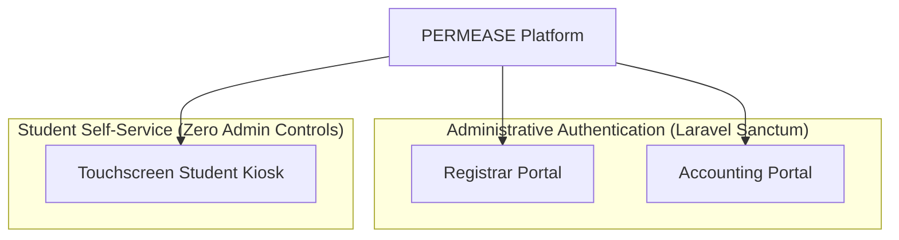
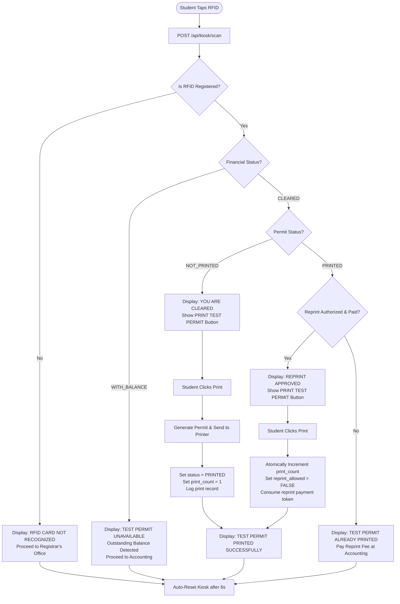
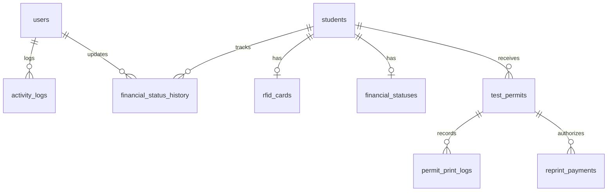

# PERMEASE – RFID-Based Student Test Permit Management System
### Comprehensive System Architecture & Engineering Specification

---

## 📌 Executive Summary & Project Title

**Project Title:** PERMEASE – RFID-Based Student Test Permit Management System  
**System Classification:** Academic Enterprise Information System / Hardware-Integrated Campus Kiosk  
**Primary Objective:** Automate, secure, and streamline student test permit issuance, eligibility validation, financial clearance tracking, and RFID hardware-based touchless student identification for examinations.

---

## 🛠️ Technology Stack Architecture

### Backend & API Framework
- **Core Framework:** [Laravel 11.x](file:///c:/xampp/htdocs/permease) (PHP 8.2+)
- **Architecture:** RESTful API & Service Layer Pattern
- **Authentication & Security:** Laravel Sanctum (Token-based SPA Authentication)
- **Database Engine:** MySQL 8.0+ (InnoDB Engine, ACID-Compliant Transactions)
- **Object-Relational Mapping:** Laravel Eloquent ORM with strict typing, Enums, and Model Policies
- **Hardware Integration:** RFID Bridge Service Abstraction (Serial / USB HID / ESP32 Microcontroller via Webhooks / Local Agent)

### Frontend Client Applications
- **Application Core:** React 19 + TypeScript (Vite-Powered SPA) located in [`frontend/`](file:///c:/xampp/htdocs/permease/frontend)
- **Routing Engine:** React Router 7 (`react-router-dom`)
- **State Management & Data Fetching:** TanStack Query (React Query v5) with optimistic updates and cache invalidation
- **Form Management & Schema Validation:** React Hook Form + Zod Schema Validation
- **Styling & Design Tokens:** Tailwind CSS v4 + Vanilla CSS Design Tokens
- **Micro-Animations & Transitions:** Framer Motion
- **Iconography:** Lucide React
- **Toast Notifications:** Sonner
- **Alerts & Confirmations:** SweetAlert2
- **Analytics & Visualizations:** Recharts
- **Document Printing:** React-to-Print / jsPDF (Dedicated print-only stylesheet and layouts)
- **Hardware Target Devices:** Responsive Web App (Desktop, Tablet, Mobile Drawer) + Dedicated Fullscreen Touchscreen Kiosk Display

---

## 🎨 1. Design & UI Theme Specifications

### 1.1 Color Palette & Institutional Aesthetic
The interface is derived from the institutional **PERMEASE** visual identity—authoritative, clean, academic, and enterprise-grade:

| Color Token | Hex Code | Role & Usage |
| :--- | :--- | :--- |
| **Deep Navy Blue** | `#0B1B3D` | Primary brand tone, header bars, dark sidebar backgrounds, primary typography |
| **Royal Blue** | `#1E40AF` | Primary interactive elements, focused borders, subtle gradient endpoints |
| **Metallic Gold** | `#D4AF37` | Active navigation highlights, primary call-to-action badges, status borders, luxury accents |
| **Champagne Gold** | `#F3E5AB` | Subtle highlight badges, gold hover backgrounds, secondary status glows |
| **Pure White** | `#FFFFFF` | Card surfaces, modal containers, permit document canvas |
| **Light Institutional Gray** | `#F8FAFC` | Application body background, table alternating rows, skeleton base |
| **Status Green (Cleared)** | `#10B981` | Financial clearance, successful taps, verified test permits |
| **Status Red/Amber (Blocked)**| `#EF4444` / `#F59E0B` | Outstanding financial balance, unauthorized reprint attempts, unrecognized RFID |

> [!IMPORTANT]
> **Aesthetic Restraint:** The UI must avoid excessive colors or rainbow palettes. Maintain generous white space, subtle navy-to-blue gradients, and reserved metallic gold accents for interactive cues.

### 1.2 Component Styling & Geometry
- **Border Radius:** `12px` to `18px` on cards, dialogs, and panels.
- **Elevation / Shadows:** Soft, diffuse ambient drop shadows (`box-shadow: 0 10px 25px -5px rgba(11, 27, 61, 0.05)`).
- **Typography:** Modern, clean sans-serif typography (`Inter`, `Plus Jakarta Sans`, or `Outfit`).
- **Interactive States:** Smooth hover and focus states with `150ms–200ms` cubic-bezier transitions.

### 1.3 Framer Motion Animation Guidelines
- **Page Transitions:** Gentle fade-ins and vertical stagger (`y: 8px -> 0px`).
- **Modals & Dialogs:** Smooth scale (`scale: 0.95 -> 1`) with backdrop blur.
- **RFID Scanner & Radar:** Subtle pulsing waves emanating from the RFID badge icon on the kiosk screen.
- **Feedback Alerts:** Fluid checkmark paths for success states and shake animations for unrecognized tags.

### 1.4 Skeleton Loading Strategy
- Plain text "Loading..." indicators are strictly prohibited.
- Every API-driven data component (Dashboard KPIs, Student Roster Table, Profile Inspector, Payment Ledger, Kiosk Tap Verification) must provide a tailored SVG or pulse skeleton matching the exact bounding dimensions of the target content.

---

## 👥 2. User Roles & Access Control (RBAC)

The system defines three decoupled interfaces and permission contexts:



### 2.1 Role Capabilities

#### 1. Registrar
- Register student profiles and manage academic records.
- Launch the RFID Assignment Modal and link physical RFID UIDs to student records.
- Replace damaged, lost, or updated RFID cards with full history tracking.
- Search, filter, and review student directory entries and test permit print status.

#### 2. Accounting
- Query student profiles by Student Number, Full Name, or RFID Card UID.
- Inspect and toggle financial clearance status (`CLEARED` vs `WITH_BALANCE`).
- Process test permit reprint fee payments, recording reference numbers and authorized re-print tokens.
- Access complete audit trails of financial status updates and reprint payment transactions.
- **Constraint:** Accounting cannot alter academic records (courses, programs, year levels).

#### 3. Touchscreen Kiosk
- Dedicated fullscreen interface running at `/kiosk`.
- Exclusively driven by student RFID card taps without administrative controls or navigation menus.
- Real-time communication with the backend to inspect eligibility and invoke hardware permit printers.

---

## 📝 3. Student Registration & RFID Pairing Workflow

### 3.1 Student Registration Attributes

```text
[Personal Information]
├── First Name
├── Middle Name (Optional)
└── Last Name

[Academic Information]
├── Grade / Year Level (e.g., 1st Year, 2nd Year, 3rd Year, 4th Year)
├── Section (e.g., Section A)
├── Course (e.g., Bachelor of Science)
└── Program (e.g., Information Technology)

[Identifier]
└── Student Number (Unique format: YYYY-XXXXX)
```

### 3.2 RFID Reader Detection Modal
Manual typing of RFID UIDs is disabled during standard enrollment to avoid human error.
1. The Registrar fills in student academic and personal information.
2. The Registrar clicks **"REGISTER & ASSIGN RFID"**.
3. A modal opens with an animated RFID scanning prompt:

```text
┌────────────────────────────────────────────────────────┐
│                   Assign RFID Card                     │
│                                                        │
│  Student:     JUAN DELA CRUZ                           │
│  Student No:  2026-00001                               │
│                                                        │
│             [ 📡 Animated RFID Card Icon ]             │
│                                                        │
│               Waiting for RFID card...                 │
│        Please tap the student's RFID card              │
│               on the RFID reader.                      │
│                                                        │
│                      [ CANCEL ]                        │
└────────────────────────────────────────────────────────┘
```

4. Hardware reader captures the contactless card and transmits `rfid_uid`.
5. System verifies uniqueness:
   - **Collision:** If assigned to another student, reject with alert: *"This RFID card is already assigned to another student."*
   - **Valid:** Card is paired, student record is created, and an initial test permit record is prepared.
6. Animated success state confirms:
   - Student Name
   - Student Number
   - Registered RFID UID

---

## 📊 4. Registrar Dashboard Specifications

### 4.1 Key Performance Indicators (KPI Cards)
- **Total Registered Students**
- **Active RFID Cards Linked**
- **Students with Outstanding Balance**
- **Cleared Students**
- **Permits Issued Today**

### 4.2 Recent System Activity Stream
Chronological feed detailing:
- Student enrollment
- RFID assignment & card replacement
- Permit prints and authorized reprints
- Clearance status modifications

### 4.3 Searchable Student Roster Table
- **Columns:** Student Number, Student Name, Grade/Year Level, Section, Course & Program, RFID Tag Status, Financial Status, Permit Issuance State, Actions.
- **Controls:** Debounced search, multi-attribute dropdown filters, pagination, and skeleton loaders.

---

## 💰 5. Accounting Module & Financial Ledger

### 5.1 Financial Clearance States
- **CLEARED (Green Badge):** Student is in good financial standing; permits can be issued at the Kiosk.
- **WITH BALANCE (Amber/Red Badge):** Student has unpaid obligations; kiosk permit generation is locked.

### 5.2 Status Transition Auditing
Every toggle between `CLEARED` and `WITH_BALANCE` generates an immutable entry in `financial_status_history`:
- Previous Status
- New Status
- Operator (Accounting User ID)
- Timestamp & Notes

---

## 🖥️ 6. Kiosk Touchscreen Interface (`/kiosk`)

### 6.1 Default Idle State
- High-contrast institutional branding with the PERMEASE logo.
- Clear title: **"TEST PERMIT KIOSK"**.
- Central instructional cue: *"Tap your RFID card to continue"*.
- Smooth looping radar pulse animation surrounding the contactless card illustration.

### 6.2 Student Identification Card
Upon detecting an RFID card, display the student badge:
- Full Student Name
- Student Number
- Program & Course
- Year Level & Section
- Live Account Status (`CLEARED` or `WITH BALANCE`)

---

## 🛑 7. Business Rules: Balance, Initial Print & Reprint Logic



### 7.1 Strict Single-Print & Reprint Fee Policy
1. **Initial Print:** Every cleared student is permitted exactly **one (1)** complimentary permit print per examination period (`print_count = 1`).
2. **Subsequent Scans:** If a student taps again after the initial print, the kiosk shows:
   > *"TEST PERMIT ALREADY PRINTED — To print another copy, please pay the reprint fee at the Accounting Office."*
3. **Reprint Authorization:**
   - Accounting receives payment, logs the transaction (`amount`, `reference_number`), and sets `reprint_allowed = TRUE`.
   - The student returns to the kiosk and taps their card.
   - The kiosk displays **"REPRINT APPROVED"** and provides the **PRINT TEST PERMIT** button.
   - Upon printing, `print_count` is incremented, and `reprint_allowed` is immediately reverted to `FALSE` in a single atomic database transaction.
   - **Rule:** One payment authorizes exactly one reprint copy.

---

## 📄 8. Test Permit Printable Layout (`/print/permit/:id`)

The printed document utilizes dedicated CSS media queries (`@media print`) stripping all web navigation, buttons, and sidebars:

```text
┌────────────────────────────────────────────────────────────────────────┐
│  [ PERMEASE INSTITUTIONAL EMBLEM ]                                     │
│  OFFICIAL STUDENT EXAMINATION PERMIT                                   │
│  ACADEMIC YEAR: 2026-2027 | 1ST SEMESTER | MIDTERM EXAMINATIONS        │
├────────────────────────────────────────────────────────────────────────┤
│  PERMIT NO: TP-2026-000001             DATE ISSUED: 2026-09-27 10:45 AM │
├────────────────────────────────────────────────────────────────────────┤
│  STUDENT NAME:     JUAN DELA CRUZ                                      │
│  STUDENT NUMBER:   2026-00001                                          │
│  COURSE & PROGRAM: BS INFORMATION TECHNOLOGY                           │
│  YEAR & SECTION:   3RD YEAR - SECTION A                                │
├────────────────────────────────────────────────────────────────────────┤
│  FINANCIAL CLEARANCE:  OFFICIALLY CLEARED                              │
│  ISSUANCE TYPE:        ORIGINAL ISSUE (PRINT #1)                       │
├────────────────────────────────────────────────────────────────────────┤
│  SCHEDULE & SIGNATURE MATRIX:                                          │
│  ┌──────────────────────┬─────────────┬─────────────┬───────────────┐  │
│  │ Course Subject       │ Date & Room │ Time        │ Proctor Sign. │  │
│  ├──────────────────────┼─────────────┼─────────────┼───────────────┤  │
│  │ CS 301 - Database II │ Oct 12, 301 │ 08:00-10:00 │ ____________  │  │
│  │ CS 304 - Web Dev III │ Oct 13, 204 │ 10:30-12:30 │ ____________  │  │
│  │ CS 309 - Systems Arc │ Oct 14, 402 │ 01:00-03:00 │ ____________  │  │
│  └──────────────────────┴─────────────┴─────────────┴───────────────┘  │
│                                                                        │
│  [ QR Code Verification ]        ____________________________________  │
│  Secure SHA256 Token Digest           University Registrar Seal        │
└────────────────────────────────────────────────────────────────────────┘
```

---

## 🗄️ 9. Normalized MySQL Database Schema



### Table Definitions

#### `users`
| Column | Type | Constraints | Description |
| :--- | :--- | :--- | :--- |
| `id` | BIGINT UNSIGNED | PK, Auto Increment | Internal User ID |
| `name` | VARCHAR(255) | NOT NULL | User's full name |
| `email` | VARCHAR(255) | UNIQUE, NOT NULL | Staff institutional login email |
| `password` | VARCHAR(255) | NOT NULL | Hashed password |
| `role` | ENUM | NOT NULL | `'REGISTRAR'`, `'ACCOUNTING'`, `'ADMIN'` |
| `created_at` / `updated_at` | TIMESTAMP | NULLABLE | Timestamps |

#### `students`
| Column | Type | Constraints | Description |
| :--- | :--- | :--- | :--- |
| `id` | BIGINT UNSIGNED | PK, Auto Increment | Internal Student ID |
| `student_number` | VARCHAR(64) | UNIQUE, NOT NULL | School Student Number (Indexed) |
| `first_name` | VARCHAR(100) | NOT NULL | Given name |
| `middle_name` | VARCHAR(100) | NULLABLE | Middle name |
| `last_name` | VARCHAR(100) | NOT NULL | Family surname |
| `grade_year_level` | VARCHAR(50) | NOT NULL | Year / Grade level |
| `section` | VARCHAR(50) | NOT NULL | Class section assignment |
| `course` | VARCHAR(100) | NOT NULL | General academic discipline |
| `program` | VARCHAR(150) | NOT NULL | Specific degree program |
| `status` | ENUM | DEFAULT `'ACTIVE'` | `'ACTIVE'`, `'INACTIVE'`, `'GRADUATED'` |
| `created_at` / `updated_at` | TIMESTAMP | NULLABLE | Timestamps |

#### `rfid_cards`
| Column | Type | Constraints | Description |
| :--- | :--- | :--- | :--- |
| `id` | BIGINT UNSIGNED | PK, Auto Increment | RFID Record ID |
| `student_id` | BIGINT UNSIGNED | FK -> students.id | Linked Student |
| `rfid_uid` | VARCHAR(64) | UNIQUE, NOT NULL | Physical Card UID (Indexed) |
| `status` | ENUM | DEFAULT `'ACTIVE'` | `'ACTIVE'`, `'LOST'`, `'DEACTIVATED'` |
| `registered_by` | BIGINT UNSIGNED | FK -> users.id | Registrar who enrolled the tag |
| `registered_at` | TIMESTAMP | NOT NULL | Initial enrollment time |
| `created_at` / `updated_at` | TIMESTAMP | NULLABLE | Timestamps |

#### `financial_statuses`
| Column | Type | Constraints | Description |
| :--- | :--- | :--- | :--- |
| `id` | BIGINT UNSIGNED | PK, Auto Increment | Status Record ID |
| `student_id` | BIGINT UNSIGNED | UNIQUE, FK -> students.id | Linked Student |
| `status` | ENUM | DEFAULT `'WITH_BALANCE'`| `'CLEARED'`, `'WITH_BALANCE'` |
| `updated_by` | BIGINT UNSIGNED | FK -> users.id | Accounting Officer |
| `updated_at` | TIMESTAMP | NOT NULL | Last update timestamp |

#### `financial_status_history`
| Column | Type | Constraints | Description |
| :--- | :--- | :--- | :--- |
| `id` | BIGINT UNSIGNED | PK, Auto Increment | History Record ID |
| `student_id` | BIGINT UNSIGNED | FK -> students.id | Linked Student |
| `previous_status` | ENUM | NOT NULL | `'CLEARED'`, `'WITH_BALANCE'` |
| `new_status` | ENUM | NOT NULL | `'CLEARED'`, `'WITH_BALANCE'` |
| `notes` | TEXT | NULLABLE | Reason or reference note |
| `updated_by` | BIGINT UNSIGNED | FK -> users.id | Operator |
| `created_at` | TIMESTAMP | NOT NULL | Timestamp of status modification |

#### `test_permits`
| Column | Type | Constraints | Description |
| :--- | :--- | :--- | :--- |
| `id` | BIGINT UNSIGNED | PK, Auto Increment | Permit ID |
| `student_id` | BIGINT UNSIGNED | FK -> students.id | Linked Student |
| `permit_number` | VARCHAR(64) | UNIQUE, NOT NULL | Formatted Number (`TP-YYYY-XXXXXX`) |
| `academic_year` | VARCHAR(20) | NOT NULL | E.g., `'2026-2027'` |
| `semester` | VARCHAR(20) | NOT NULL | E.g., `'1st Semester'` |
| `exam_period` | VARCHAR(50) | NOT NULL | E.g., `'Midterm'`, `'Final'` |
| `status` | ENUM | DEFAULT `'AVAILABLE'` | `'AVAILABLE'`, `'PRINTED'`, `'BLOCKED'` |
| `print_count` | INT UNSIGNED | DEFAULT 0 | Total number of prints executed |
| `reprint_allowed` | BOOLEAN | DEFAULT FALSE | Single-use reprint authorization token |
| `first_printed_at` | TIMESTAMP | NULLABLE | Initial print timestamp |
| `last_printed_at` | TIMESTAMP | NULLABLE | Most recent print timestamp |
| `created_at` / `updated_at` | TIMESTAMP | NULLABLE | Timestamps |

#### `reprint_payments`
| Column | Type | Constraints | Description |
| :--- | :--- | :--- | :--- |
| `id` | BIGINT UNSIGNED | PK, Auto Increment | Payment ID |
| `student_id` | BIGINT UNSIGNED | FK -> students.id | Linked Student |
| `test_permit_id` | BIGINT UNSIGNED | FK -> test_permits.id | Associated Permit |
| `amount` | DECIMAL(10,2) | NOT NULL | Payment amount charged |
| `reference_number` | VARCHAR(100) | UNIQUE, NOT NULL | Official receipt / payment reference |
| `status` | ENUM | DEFAULT `'PAID'` | `'PAID'`, `'CONSUMED'`, `'VOID'` |
| `processed_by` | BIGINT UNSIGNED | FK -> users.id | Accounting Cashier |
| `paid_at` | TIMESTAMP | NOT NULL | Transaction time |
| `consumed_at` | TIMESTAMP | NULLABLE | Time student tapped & printed reprint |
| `created_at` / `updated_at` | TIMESTAMP | NULLABLE | Timestamps |

#### `permit_print_logs`
| Column | Type | Constraints | Description |
| :--- | :--- | :--- | :--- |
| `id` | BIGINT UNSIGNED | PK, Auto Increment | Log ID |
| `student_id` | BIGINT UNSIGNED | FK -> students.id | Student |
| `test_permit_id` | BIGINT UNSIGNED | FK -> test_permits.id | Test Permit |
| `print_type` | ENUM | NOT NULL | `'INITIAL'`, `'REPRINT'` |
| `reprint_payment_id` | BIGINT UNSIGNED | NULLABLE, FK -> reprint_payments.id | Associated payment token if reprint |
| `kiosk_identifier` | VARCHAR(100) | NOT NULL | Device name / Station IP |
| `printed_at` | TIMESTAMP | NOT NULL | Execution timestamp |

#### `activity_logs`
| Column | Type | Constraints | Description |
| :--- | :--- | :--- | :--- |
| `id` | BIGINT UNSIGNED | PK, Auto Increment | Log Entry ID |
| `user_id` | BIGINT UNSIGNED | NULLABLE, FK -> users.id | Acting User |
| `action` | VARCHAR(100) | NOT NULL | Action identifier |
| `description` | TEXT | NOT NULL | Human-readable audit narrative |
| `ip_address` | VARCHAR(45) | NOT NULL | Client IP Address |
| `created_at` | TIMESTAMP | NOT NULL | Entry timestamp |

---

## 🔒 10. Security Architecture & Server-Side Validation

1. **Zero Client Trust:** React clients never calculate or decide permit eligibility. The frontend merely reflects server evaluations delivered through validated Sanctum and Kiosk endpoints.
2. **Transaction Isolation:** Consuming reprint authorizations runs inside `DB::transaction()` with pessimistic row locking (`lockForUpdate()`) to prevent race conditions from multiple simultaneous kiosk scans.
3. **Card Uniqueness Verification:** Database-enforced `UNIQUE` indices guarantee an RFID tag can only ever link to a single active student.
4. **Rate Limiting:** Dedicated rate limiters protect the `/api/kiosk/scan` endpoint against brute-force UID enumeration.

---

## 🌐 11. REST API Specification

### Authentication Routes
| Method | Endpoint | Request Payload | Description |
| :--- | :--- | :--- | :--- |
| `POST` | `/api/login` | `{ email, password }` | Authenticate staff member & issue Sanctum token |
| `POST` | `/api/logout` | None (Sanctum Auth) | Invalidate current session token |
| `GET` | `/api/user` | None (Sanctum Auth) | Retrieve authenticated profile and role |

### Registrar Routes
| Method | Endpoint | Request Payload | Description |
| :--- | :--- | :--- | :--- |
| `GET` | `/api/students` | Query: `search`, `year`, `status`, `page` | Paginated student roster |
| `POST` | `/api/students` | `{ student_number, first_name, ... }` | Create student profile |
| `GET` | `/api/students/{id}` | None | Retrieve student profile details |
| `PUT` | `/api/students/{id}` | Updated student attributes | Edit academic/personal information |
| `POST` | `/api/students/{id}/rfid`| `{ rfid_uid }` | Register and pair an RFID card |
| `PUT` | `/api/students/{id}/rfid`| `{ rfid_uid, reason }` | Replace RFID card and log old card |

### Accounting Routes
| Method | Endpoint | Request Payload | Description |
| :--- | :--- | :--- | :--- |
| `GET` | `/api/accounting/students` | Query: `search`, `status`, `page` | Search students for financial status |
| `GET` | `/api/accounting/students/{id}` | None | View financial and permit history |
| `PUT` | `/api/accounting/students/{id}/financial-status` | `{ status, notes }` | Toggle `CLEARED` or `WITH_BALANCE` |
| `POST` | `/api/accounting/students/{id}/reprint-payment` | `{ amount, reference_number, notes }` | Authorize a single reprint |

### Kiosk Routes
| Method | Endpoint | Request Payload | Description |
| :--- | :--- | :--- | :--- |
| `POST` | `/api/kiosk/scan` | `{ rfid_uid }` | Scan card, identify student, evaluate eligibility |
| `POST` | `/api/kiosk/print` | `{ rfid_uid, kiosk_id }` | Execute initial print and log |
| `POST` | `/api/kiosk/reprint` | `{ rfid_uid, kiosk_id }` | Execute reprint and consume payment token |

### Dashboard & Analytics Routes
| Method | Endpoint | Description |
| :--- | :--- | :--- |
| `GET` | `/api/dashboard/statistics` | Aggregated counters, print stats, and financial metrics |
| `GET` | `/api/activity` | Activity audit stream |

---

## 📡 12. RFID Hardware Layer & Bridge Architecture

```text
┌────────────────────────┐
│ Contactless RFID Card  │
└───────────┬────────────┘
            │  13.56 MHz (Mifare) or 125 kHz
            ▼
┌────────────────────────┐
│  Hardware RFID Reader  │ (USB HID / Serial COM / ESP32 Controller)
└───────────┬────────────┘
            │  Raw UID Stream
            ▼
┌────────────────────────┐
│ Local Hardware Bridge  │ (Lightweight WebSockets / Keystroke Emulation / Node Agent)
└───────────┬────────────┘
            │  Standardized JSON { rfid_uid: "A1B2C3D4" }
            ▼
┌────────────────────────┐
│  Laravel API Service   │ (Validation, RBAC, Eligibility, DB Storage)
└───────────┬────────────┘
            │  Live State Response
            ▼
┌────────────────────────┐
│   React Kiosk Client   │ (Framer Motion UI, Audio Feedback, Print Dispatcher)
└────────────────────────┘
```

The system decouples hardware readers from the frontend presentation layer. React components never parse raw USB serial bytes directly; instead, they receive clean events from the RFID Bridge layer or standard HID keyboard wedges.

---

## 🏛️ 13. Application Layout & Navigation Structure

### Administrative Dashboard Layout
- **Sidebar (Collapsible):**
  - **Header:** PERMEASE Institutional Branding & Emblem
  - **Core Menu:**
    - `Dashboard`
    - **Registrar Section:**
      - `Students Directory`
      - `Register Student`
      - `RFID Card Management`
      - `Permit Issuance Records`
    - **Accounting Section:**
      - `Student Accounts`
      - `Balance Clearance`
      - `Reprint Payments`
      - `Payment History`
    - **System Management:**
      - `Activity Logs`
  - **Footer:** Active User Identity, Role Badge, Logout Button

### Kiosk Interface Layout
- **Full-Screen Display:** Devoid of administrative menus, navigation bars, or browser frames.
- **Touch-Optimized Controls:** Buttons designed with a minimum touch target of `56px`.
- **High-Visibility Typography:** Clear readability from a standing distance of 1 to 2 meters.

---

## 📁 14. Project Directory Blueprint

```text
permease/
├── app/
│   ├── Enums/
│   │   ├── FinancialStatus.php
│   │   ├── PermitStatus.php
│   │   └── UserRole.php
│   ├── Http/
│   │   ├── Controllers/
│   │   │   ├── Api/
│   │   │   │   ├── AccountingController.php
│   │   │   │   ├── AuthController.php
│   │   │   │   ├── DashboardController.php
│   │   │   │   ├── KioskController.php
│   │   │   │   └── RegistrarController.php
│   │   ├── Requests/
│   │   │   ├── RegisterStudentRequest.php
│   │   │   ├── ReprintPaymentRequest.php
│   │   │   └── UpdateFinancialStatusRequest.php
│   │   └── Resources/
│   │       ├── StudentResource.php
│   │       └── TestPermitResource.php
│   ├── Models/
│   │   ├── ActivityLog.php
│   │   ├── FinancialStatus.php
│   │   ├── FinancialStatusHistory.php
│   │   ├── PermitPrintLog.php
│   │   ├── ReprintPayment.php
│   │   ├── RfidCard.php
│   │   ├── Student.php
│   │   ├── TestPermit.php
│   │   └── User.php
│   └── Services/
│       ├── KioskEligibilityService.php
│       ├── PermitPrintingService.php
│       └── RfidService.php
├── database/
│   └── migrations/
│       ├── 2026_09_27_000001_create_students_table.php
│       ├── 2026_09_27_000002_create_rfid_cards_table.php
│       ├── 2026_09_27_000003_create_financial_statuses_table.php
│       ├── 2026_09_27_000004_create_financial_status_history_table.php
│       ├── 2026_09_27_000005_create_test_permits_table.php
│       ├── 2026_09_27_000006_create_reprint_payments_table.php
│       ├── 2026_09_27_000007_create_permit_print_logs_table.php
│       └── 2026_09_27_000008_create_activity_logs_table.php
├── frontend/
│   ├── src/
│   │   ├── api/
│   │   │   ├── client.ts
│   │   │   ├── accounting.ts
│   │   │   ├── kiosk.ts
│   │   │   └── registrar.ts
│   │   ├── components/
│   │   │   ├── cards/
│   │   │   │   ├── KioskStudentCard.tsx
│   │   │   │   └── MetricCard.tsx
│   │   │   ├── feedback/
│   │   │   │   ├── RfidPulseScanner.tsx
│   │   │   │   └── SkeletonTable.tsx
│   │   │   ├── layouts/
│   │   │   │   ├── AdminLayout.tsx
│   │   │   │   ├── KioskLayout.tsx
│   │   │   │   └── Sidebar.tsx
│   │   │   ├── modals/
│   │   │   │   ├── AssignRfidModal.tsx
│   │   │   │   └── ReprintPaymentModal.tsx
│   │   │   └── permits/
│   │   │       └── TestPermitDocument.tsx
│   │   ├── pages/
│   │   │   ├── accounting/
│   │   │   │   ├── BalanceManagement.tsx
│   │   │   │   └── ReprintLedger.tsx
│   │   │   ├── kiosk/
│   │   │   │   └── KioskTerminal.tsx
│   │   │   ├── registrar/
│   │   │   │   ├── RegisterStudent.tsx
│   │   │   │   ├── RfidInventory.tsx
│   │   │   │   └── StudentRoster.tsx
│   │   │   └── Dashboard.tsx
│   │   ├── types/
│   │   │   └── index.ts
│   │   ├── App.tsx
│   │   └── main.tsx
│   ├── package.json
│   └── vite.config.ts
├── routes/
│   └── api.php
└── PROJECT_SPECIFICATION.md
```

---

## 🎯 15. Expected System Behavior Summary

The completed PERMEASE platform provides an enterprise academic solution:
1. **Security & Integrity:** Strict server-side verification ensures permits cannot be printed when balances are due or unearned duplicate copies requested.
2. **Speed & Efficiency:** Registrars can enroll and pair RFID cards within seconds; students tap and receive permits at the kiosk without staff intervention.
3. **High-Value User Experience:** Rich design tokens (Deep Navy, Royal Blue, Metallic Gold, and Clean Whites) paired with skeleton states and Framer Motion micro-animations deliver an institutional-grade experience.
